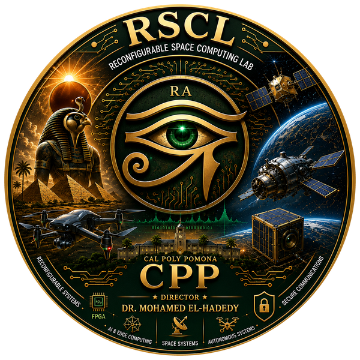
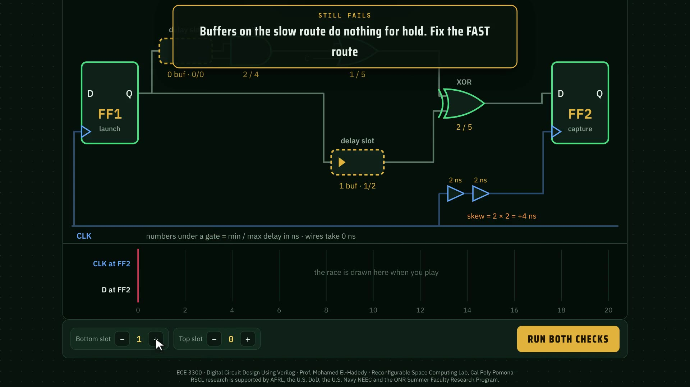
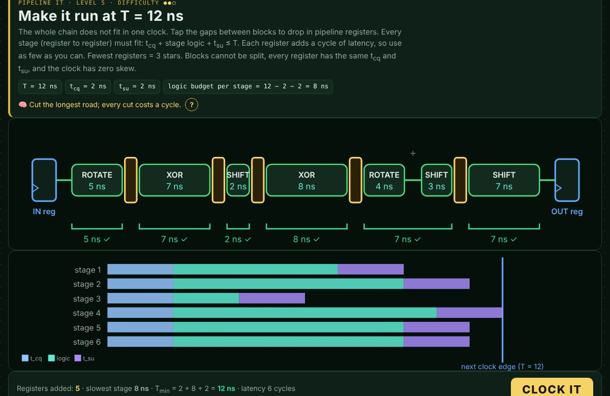
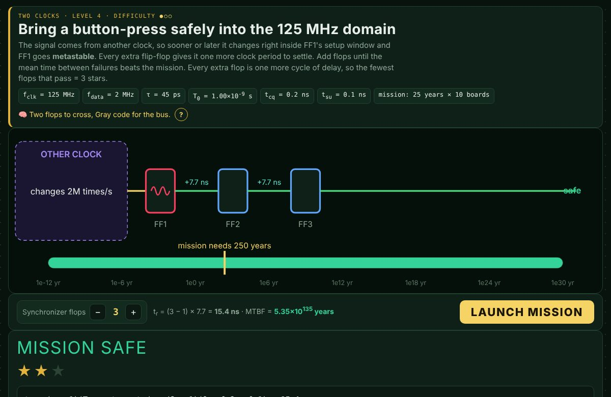
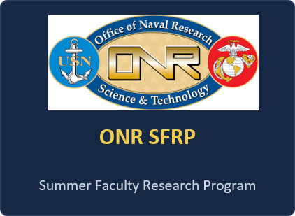

<p align="center"></p>

<h1 align="center">Race the Clock</h1>
<p align="center"><b>The ECE 3300 timing game: data versus the clock edge.</b><br>
Reconfigurable Space Computing Lab (RSCL) · Cal Poly Pomona · Prof. Mohamed El-Hadedy</p>

<p align="center"><a href="https://mealycpp.github.io/tutorials/race-the-clock/"><b>▶ Play in your browser</b></a> · <a href="https://mealycpp.github.io/tutorials/race-the-clock/trailer.html">Watch the trailer</a></p>

<p align="center"><a href="https://mealycpp.github.io/tutorials/race-the-clock/trailer.html"></a></p>

---

Every timing question is a race. When the clock ticks, new data leaves FF1 and runs through the gates. FF2 is waiting for the next tick. The data has to get there **in time** (setup), but **not too early** (hold). This game turns setup, hold, skew and Fmax into something you play, watch, and break, then shows you the exam formula with your own numbers.


## The worlds

Three tiers, from the exam to flight hardware. Every world starts with a one-minute tutorial (a story, a rhyme to remember the equation, the recipe, and one practice question). Press **T** for the tutorial or **Enter** to jump straight to the challenge.

| Tier | World | What you do | What it teaches |
|---|---|---|---|
| Campus | **1 · Pathfinder** | Tap the gates on the slowest route (setup) or the fastest route (hold). | Picking the right path, with max or min delays |
| Campus | **2 · Beat the Clock** | Drag the clock period and press FIRE. The data races the next edge. | Setup slack, clock skew, Fmax |
| Campus | **3 · Too Fast!** | Drop delay buffers into slots to fix hold without breaking setup. | Hold slack and the setup/hold trade-off |
| Campus | **Boss · Exam Mode** | 90 seconds of exam-style questions on random circuits. | Speed and accuracy on the formulas |
| Industry (★ 30) | **4 · Pipeline It** | Drop pipeline registers into a chain so every stage fits the clock, with as few as possible. | Pipelining, latency vs throughput |
| Industry | **5 · Read the Report** | Fill in arrival, required and slack in a timing report, then WNS and TNS. | Reading static timing reports |
| Industry | **6 · Hot, Cold & Shaky** | Check setup at the slow corner with jitter and hold at the fast corner. | PVT corners, clock jitter |
| Flight Hardware (★ 70) | **7 · Two Clocks** | Add synchronizer flip-flops until the MTBF beats the mission; cross buses in Gray code. | Metastability, MTBF, clock domain crossing |
| Flight Hardware | **8 · Radiation** | Watch a particle flip a copy, vote with TMR, pay the voter's delay, find when a glitch gets latched. | SEU, TMR, SET latching, reliability |
| Flight Hardware | **Final Boss · Flight Readiness Review** | 120 seconds, every topic mixed. | Everything |

**Question Jungle.** Each tier also has drill trails (10 levels each) built from a question bank of 243 generators and 379 fixed questions, plus 242 "trap" notes shown before each trail: setup/hold traps, multi-path Fmax, clocking and latches, pipelining, report reading, corners and OCV, interview-style puzzles, clock domain crossing, and radiation. Every prompt states its assumptions (ideal clock, same-edge path, worst-case model, and so on), so each question has exactly one defensible answer. Every generator has a machine-checked guard, so the random numbers always make a sensible question with four different answers. A wrong answer shows the exact mistake that leads to it.

The first levels use the circuits from the ECE 3300 lectures and Midterm 2. After that, generators build new circuits and new numbers every time.







## Stars, tiers and ranks

- Each level gives up to 3 stars. 3 stars means the best possible answer: the exact minimum period, the fewest buffers, the fewest pipeline registers, the fewest synchronizer flops, or every question right.
- Industry opens at ★ 30 and Flight Hardware at ★ 70.
- Ranks: Intern → Junior Engineer → Timing Engineer → Senior Engineer → Signoff Lead → Principal Engineer → Flight Hardware Engineer → Mission Lead → Chief Architect → Fellow.
- Progress is saved in your own browser. Nothing is sent anywhere.

**For instructors:** add `#unlock` to the address (for example `https://mealycpp.github.io/tutorials/race-the-clock/#unlock`) to open every world and level.

## The formulas the game uses

These are the same formulas printed on the ECE 3300 exams:

```
Setup slack = T − ( t_cq,max + t_c,max + t_su − t_skew )
Hold slack  = t_cq,min + t_c,min − t_skew − t_h
Fmax        = 1 / ( t_cq,max + t_c,max + t_su − t_skew )
Pipeline    T_min = t_cq + slowest stage + t_su
Report      slack = (T + dst clock − uncertainty − t_su) − (src clock + t_cq + logic + net)
Synchronizer t_r = (n − 1)(T_clk − t_cq − t_su),  MTBF = e^(t_r/τ) / (T0 · f_clk · f_data)
TMR         T_min = t_cq + t_c + t_voter + t_su
```

Clock buffers on the capture side (FF2) make t_skew positive. Wires take 0 ns. Each gate shows its min / max delay in ns.

## Run it yourself

It is one HTML file with no build step and no install. Open `index.html` in any modern browser. The live copy runs on the lab site at https://mealycpp.github.io/tutorials/race-the-clock/

## Acknowledgments

The Reconfigurable Space Computing Lab's research is supported by:

<p align="center">



</p>

AFRL (Agreement FA8650-24-2-2403) · U.S. DoD (Award W911NF-24-1-0265) · U.S. Navy NEEC (Grant N00174-23-1-0002) · ONR Summer Faculty Research Program

---

ECE 3300 · Digital Circuit Design Using Verilog · Reconfigurable Space Computing Lab, Cal Poly Pomona · [github.com/mealycpp](https://github.com/mealycpp) · [recoiot.com](https://recoiot.com)
