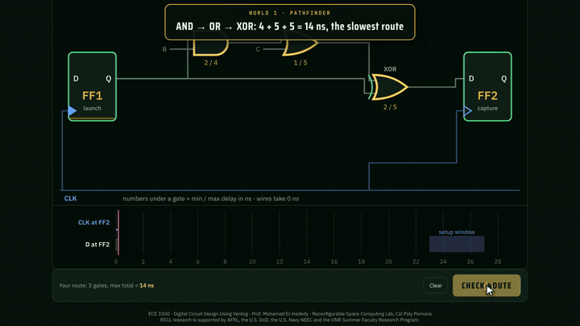
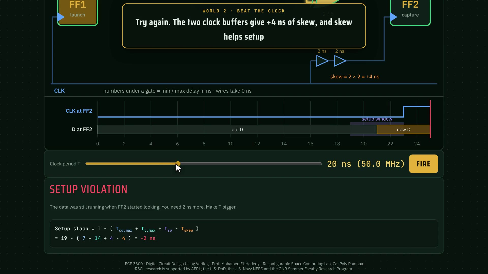

<p align="center"></p>

<h1 align="center">Race the Clock</h1>
<p align="center"><b>The ECE 3300 timing game: data versus the clock edge.</b><br>
Reconfigurable Space Computing Lab (RSCL) · Cal Poly Pomona · Prof. Mohamed El-Hadedy</p>

<p align="center"><a href="https://mealycpp.github.io/tutorials/race-the-clock/"><b>▶ Play in your browser</b></a> · <a href="https://mealycpp.github.io/tutorials/race-the-clock/trailer.html">Watch the trailer</a></p>

<p align="center"><a href="https://mealycpp.github.io/tutorials/race-the-clock/trailer.html"></a></p>

---

Every timing question is a race. When the clock ticks, new data leaves FF1 and runs through the gates. FF2 is waiting for the next tick. The data has to get there **in time** (setup), but **not too early** (hold). This game turns setup, hold, skew and Fmax into something you play, watch, and break, then shows you the exam formula with your own numbers.



## The worlds

| World | What you do | What it teaches |
|---|---|---|
| **1 · Pathfinder** | Tap the gates on the slowest route (setup) or the fastest route (hold). | Picking the right path, with max or min delays |
| **2 · Beat the Clock** | Drag the clock period and press FIRE. The data races the next edge. Find the exact minimum. | Setup slack, clock skew, Fmax |
| **3 · Too Fast!** | Drop delay buffers into slots to fix a hold violation without breaking setup. | Hold slack and the setup/hold trade-off |
| **Boss · Exam Mode** | 90 seconds of exam-style questions on random circuits, with streak multipliers. | Speed and accuracy on the formulas |

The first levels use the circuits from the ECE 3300 lectures and Midterm 2. After that, a generator builds a new circuit every time, with 1 to 4 gate columns, AND/OR/XOR/NAND/NOR/NOT gates, fan-out, side inputs, fast bypass wires and clock-buffer skew, so there is always another one to play. Every generated level is checked: pathfinder routes have exactly one answer, and hold puzzles always start failing and always have a fix.


## Stars, worlds and ranks

- Each level gives up to 3 stars. In Beat the Clock, 3 stars means the exact minimum period. In Too Fast!, it means the fewest buffers.
- World 2 opens at ★ 6 and World 3 opens at ★ 15.
- Your rank rises with your stars: Intern → Junior Engineer → Timing Engineer → Senior Engineer → Signoff Lead → Chief Architect.
- Progress is saved in your own browser. Nothing is sent anywhere.

**For instructors:** add `#unlock` to the address (for example `https://mealycpp.github.io/tutorials/race-the-clock/#unlock`) to open every world and level.

## The formulas the game uses

These are the same formulas printed on the ECE 3300 exams:

```
Setup slack = T − ( t_cq,max + t_c,max + t_su − t_skew )
Hold slack  = t_cq,min + t_c,min − t_skew − t_h
Fmax        = 1 / ( t_cq,max + t_c,max + t_su − t_skew )
```

Clock buffers on the capture side (FF2) make t_skew positive. Wires take 0 ns. Each gate shows its min / max delay in ns.

## Run it yourself

It is one HTML file with no build step and no install. Open `index.html` in any modern browser. The live copy runs on the lab site at https://mealycpp.github.io/tutorials/race-the-clock/

## Acknowledgments

The Reconfigurable Space Computing Lab's research is supported by:

<p align="center">


</p>

AFRL (Agreement FA8650-24-2-2403) · U.S. DoD (Award W911NF-24-1-0265) · U.S. Navy NEEC (Grant N00174-23-1-0002) · ONR Summer Faculty Research Program

---

ECE 3300 · Digital Circuit Design Using Verilog · Reconfigurable Space Computing Lab, Cal Poly Pomona · [github.com/mealycpp](https://github.com/mealycpp) · [recoiot.com](https://recoiot.com)
